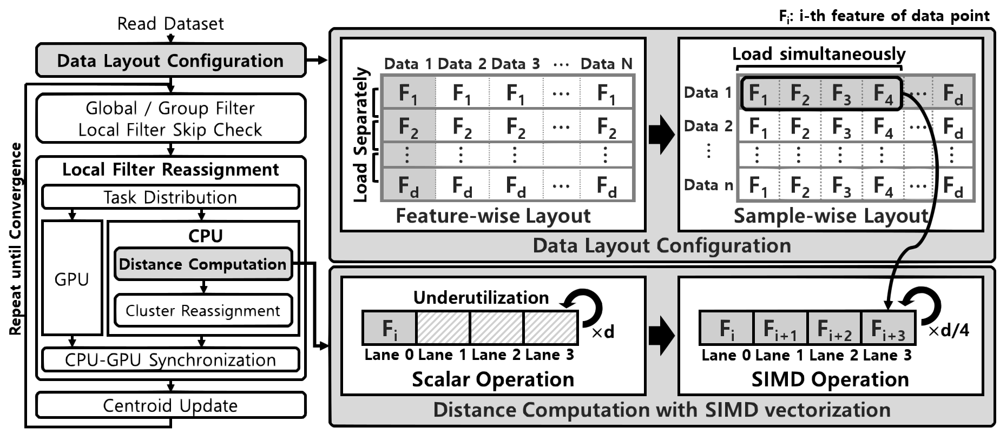

# Futurism

## Introduction

K-means clustering framework that uses both CPUs and GPUs on mobile platforms.

## Quick Start

From the repository root on a Jetson AGX Orin, build Futurism and run it with your CSV dataset. See [build requirements](#requirements) before running the scripts.

```bash
./scripts/build.sh
./scripts/run.sh /path/to/dataset.csv
```

The dataset is supplied separately. The runner expects a headerless CSV with one sample per row and at least 1,024 samples for the current cluster count.

## Build from Source

### Requirements

- Jetson AGX Orin with the NVIDIA CUDA Toolkit and `nvcc`. The build targets compute capability 8.7 and is configured for the Jetson CUDA 11.4 toolchain.
- CMake 3.13 or later in the 3.x series, and GCC/G++ with OpenMP support. The CUDA library uses C++14.
- Python 3 and `setuptools` for `setup.py`.

From the repository root, enter `src` and run `python3 setup.py build`. This calls CMake to build the CUDA shared library. Then use GCC to compile the CSV runner and link it against the library.

```bash
cd src
python3 setup.py build
gcc -std=c11 read_input.c -I. -L. -lfuturism \
    '-Wl,-rpath,$ORIGIN' -o futurism
```

The build produces `src/libfuturism.so` and `src/futurism`. After building, run `./scripts/run.sh /path/to/dataset.csv` from the repository root.

## Futurism Overview



- **Sample-wise data layout.** Stores each sample’s features contiguously in memory for efficient CPU vector loads.
- **SIMD distance computation.** Uses Arm Neon to process four features at a time when computing point-to-centroid distances.
- **CPU–GPU task distribution.** Separates skip checks from cluster reassignment and dynamically splits the remaining distance computations between the CPU and GPU.

## Citation

If you use Futurism in your research, please cite our paper. [IEEE Xplore](https://ieeexplore.ieee.org/abstract/document/11690603)

```bibtex
@article{ryu2026futurism,
  author  = {Ryu, Jaehyeok and Kong, Dowoong and Lee, Yiseok and Gil, Minseong and
             Koo, Gunjae and Yoon, Myung Kuk and Oh, Yunho},
  title   = {{Futurism}: Accelerating {K-Means} Clustering on Embedded Systems via Vector Engines},
  journal = {IEEE Embedded Systems Letters},
  year    = {2026},
  doi     = {10.1109/LES.2026.3732530}
}
```

## Acknowledgement

This work was supported in part by the National Research Foundation of Korea (NRF) funded by the Korea government (MSIT) (NRF2022R1C1C1011021 and RS-2025-02214322), and in part by the Institute of Information & Communications Technology Planning & Evaluation (IITP) grant funded by the Korea government (MSIT) (RS-2025-02304483).
